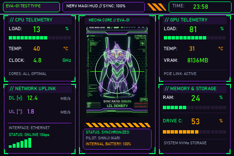
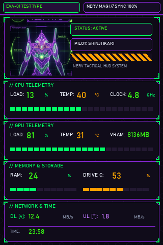

# <p align="center"> Evangelion Unit-01 (EVA-01) HUD </p>

<p align="center">
  <strong>Tema de telemetria mecha de alta performance inspirado no Evangelion Unit-01 para telas Turing Smart Screen de 3.5 polegadas.</strong>
</p>

<p align="center">
  
  
  
  
  
  
  
  
</p>

---

##  Sumário

- [Visão Geral](#-visão-geral)
- [Demonstração Visual](#-demonstração-visual)
- [Mapeamento de Telemetria](#-mapeamento-de-telemetria)
- [Estrutura do Repositório](#-estrutura-do-repositório)
- [Como Compilar os Arquivos](#-como-compilar-os-arquivos)
- [Como Instalar e Ativar no Display](#-como-instalar-e-ativar-no-display)
- [Links Úteis e Downloads](#-links-úteis-e-downloads)
- [Histórico de Versões](#-histórico-de-versões)
- [Licença](#-licença)

---

##  Visão Geral

Este projeto disponibiliza um tema de monitoramento de hardware em tempo real para o display secundário USB **Turing Smart Screen de 3.5 polegadas** (resoluções nativas de **480×320** em modo horizontal e **320×480** em modo vertical).

O design é baseado na estética tática dos cockpits e da interface **MAGI System da NERV**, utilizando a paleta oficial do **Evangelion Unit-01 (EVA-01)**:
- **Roxo Mecha Profundo (`#8C28DC` / `#2E0854`)**: Molduras chanfradas, trilhos e cantoneiras estruturais.
- **Verde Neon Fluorescente (`#00FF66` / `#39FF14`)**: Destaque das taxas de clock, cargas de uso, download e status de sincronização (`SYNC: 100%`).
- **Laranja/Âmbar NERV Alert (`#FFAA00`)**: Temperaturas críticas, aviso de emergência e uso do Drive C:.
- **Textura Carbon Hex**: Fundo escuro fosco de alto contraste que elimina reflexos e destaca o holograma aramado central do EVA-01.

---

##  Demonstração Visual

### Modo Horizontal (Landscape — 480 × 320 px)
> *Ideal para suporte de mesa padrão horizontal.*



### Modo Vertical (Portrait — 320 × 480 px)
> *Ideal para gabinetes ou suportes verticais.*



---

##  Mapeamento de Telemetria

Todas as métricas são atualizadas em tempo real pelo software sem sobreposição de textos ou barras:

| Módulo | Métrica | Identificador no Software | Formato & Cor |
| :--- | :--- | :--- | :--- |
| **CPU** | Carga de Uso (%) | `CpuLoad` | Dígitos em Verde Neon (`#39FF14`) + Barra Dinâmica LED HUD |
| **CPU** | Temperatura (°C) | `CpuTemp` | Dígitos em Âmbar NERV Alert (`#FFAA00`) com 13px de respiro |
| **CPU** | Frequência de Clock (GHz) | `CpuFreq` | Dígitos em Verde Neon |
| **GPU** | Carga de Uso (%) | `GpuLoad` | Dígitos em Verde Neon + Barra Dinâmica LED HUD |
| **GPU** | Temperatura (°C) | `GpuTemp` | Dígitos em Âmbar NERV Alert com 13px de respiro |
| **GPU** | Memória VRAM (MB) | `GpuRam` | Dígitos em Verde Neon com sufixo nativo |
| **RAM** | Uso da Memória (%) | `RamLoad` | Dígitos em Verde Neon (coluna `X = 392`) + Barra Dinâmica |
| **Drive C:** | Uso do Armazenamento (%) | `HDDLoad` | Dígitos em Âmbar NERV (coluna `X = 392`) + Barra Dinâmica |
| **Rede** | Taxa de Download (MB/s) | `InternetDown` | Dígitos em Verde Neon com indicador `DL [v]` |
| **Rede** | Taxa de Upload (MB/s) | `InternetUp` | Dígitos em Roxo Elétrico (`#C878FF`) com indicador `UL [^]` |
| **Relógio** | Horário Atual | `Time` | Sincronizado no topo direito com 4px de margem interna |

---

##  Estrutura do Repositório

```text
tss/
├── assets/
│   ├── icons/                          # Ícones SVG do projeto
│   ├── eva_center_crop.png             # Holograma do EVA-01 (Horizontal)
│   └── eva_portrait_crop.png           # Holograma do EVA-01 (Vertical)
│
├── build_theme_images.py               # Gerador procedural de backgrounds HUD (Pillow)
├── build_theme_data.ps1                # Compilador binário de temas (.data via .NET Reflection)
├── eva_01_landscape.png                # Fundo gerado 480x320
├── eva_01_portrait.png                 # Fundo gerado 320x480
├── preview_landscape.png               # Imagem de demonstração horizontal
├── preview_portrait.png                # Imagem de demonstração vertical
├── A EVA 01 Evangelion Land.data       # Pacote binário do tema horizontal
├── A EVA 01 Evangelion Port.data       # Pacote binário do tema vertical
├── .gitignore                          # Regras de exclusão do Git
└── README.md                           # Documentação oficial
```

---

##  Como Compilar os Arquivos

O pipeline de compilação é composto por duas etapas: geração das imagens de alta definição e serialização binária compatível com a arquitetura `.NET` do Turing Smart Screen.

### Pré-requisitos:
- **Python 3.10+** com biblioteca Pillow:
  ```bash
  pip install pillow
  ```
- **PowerShell 5.1 ou 7+** (com permissão de execução de scripts).

### Etapa 1: Gerar as Imagens de Fundo (PNG)
Execute o script Python para desenhar os painéis, grades hexagonais, molduras mecha e compor os hologramas:
```bash
python build_theme_images.py
```
*Saída:* Gera `eva_01_landscape.png` (480x320) e `eva_01_portrait.png` (320x480).

### Etapa 2: Compilar os Temas Binários (`.data`)
Execute o script PowerShell para serializar os temas com `BinaryFormatter`, injetar as fontes, cores neon, coordenadas absolutas e camadas OSD transparentes:
```powershell
powershell -ExecutionPolicy Bypass -File build_theme_data.ps1
```
*Saída:* Compila `A EVA 01 Evangelion Land.data` e `A EVA 01 Evangelion Port.data` e os transfere automaticamente para a pasta do seu software.

---

##  Como Instalar e Ativar no Display

Se você desejar copiar manualmente para outra máquina ou diretório:

1. **Copie os arquivos de tema para a pasta `config\`:**
   - Copie `A EVA 01 Evangelion Land.data` e `A EVA 01 Evangelion Port.data` para `C:\...\35inchENG\config\`
2. **Copie as imagens de fundo para a pasta `3.5\`:**
   - Copie `eva_01_landscape.png` e `eva_01_portrait.png` para `C:\...\35inchENG\3.5\`
3. **Ative na interface do UsbMonitor:**
   - Abra o **UsbMonitor.exe**.
   - No menu suspenso **Theme**, selecione:
     - **`A EVA 01 Evangelion Land`** (para exibição horizontal)
     - ou **`A EVA 01 Evangelion Port`** (para exibição vertical)
   - Clique no botão **Run**. O visor atualizará imediatamente.

---

##  Links Úteis e Downloads

Abaixo estão os links oficiais e recursos comunitários para download do aplicativo de gerenciamento do **Turing Smart Screen 3.5"** (`UsbMonitor.exe`), drivers e firmwares:

| Recurso | Descrição | Link de Acesso |
| :--- | :--- | :--- |
| **Download do App Turing 3.5" (Direto)** | Página de download direto dos pacotes oficiais para display 3.5" (`35inchENG.rar` / `UsbMonitor.exe`) | [Download Direto Turing 3.5 App](https://www.turzx.com/2023/03/02/%E7%9B%B4%E9%93%BE%E4%B8%8B%E8%BD%BDdirectdownload/) |
| **Portal Oficial do Fabricante (Turzx)** | Site oficial da Turzx com documentações, lançamentos e tutoriais | [https://www.turzx.com/](https://www.turzx.com/) |
| **Central de Drivers & Utilitários Turzx** | Repositório geral de drivers, temas e atualizações de firmware | [Turzx Software Center](https://www.turzx.com/2021/11/02/download/) |
| **Turing Smart Screen Python (Open Source)** | Driver e biblioteca de código aberto mantida pela comunidade para telas Turing | [GitHub - mathoudebine/turing-smart-screen-python](https://github.com/mathoudebine/turing-smart-screen-python) |

---

##  Histórico de Versões

### [v1.3.0] - 2026-10-21
- **Padronização Naming Evangelion**: Foco 100% exclusivo no tema Evangelion Unit-01 / NERV MAGI.
- **Novos Ícones no README**: Incorporação da coleção de ícones SVG estilizados e badges do ecossistema.
- **Guia de Compilação e Links**: Documentação técnica de build procedural via Python/PowerShell e links para download do software oficial.

### [v1.2.0] - 2026-10-21
- **Card RAM & Drive C:**: Reestruturação vertical com alinhamento em `X = 392` e linha divisória, sanando a colisão com o rótulo "DRIVE C:".
- **Card de Horário**: Ampliação do card de tempo (`Y = 3..25`) com 4px de respiro interno, eliminando sobreposição com a borda superior.
- **Cards CPU e GPU**: Temperaturas posicionadas com 13px de respiro abaixo das barras de LED.

### [v1.1.0] - 2026-10-21
- **Eliminação de OSD Legado**: Limpeza total da camada residual `osdImg` de círculos herdados.
- **Estabilidade do Firmware USB**: Resolução definitiva do travamento de watchdog e desconexões de porta.

### [v1.0.0] - 2026-10-21
- Release inicial dos temas Evangelion Unit-01 para display 3.5" (Landscape e Portrait).

---

##  Licença

Este projeto é disponibilizado sob a licença [MIT](LICENSE).
